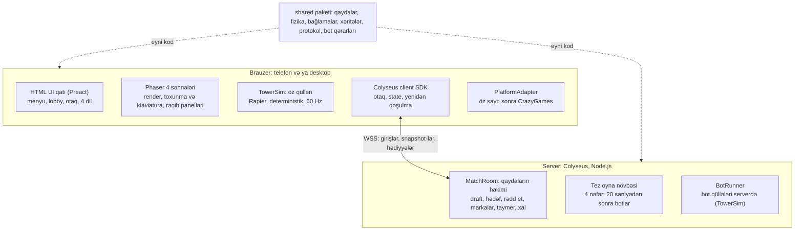

# Stampback — Texniki Arxitektura v1.0

> Mənbə: claude.ai-dakı "Stampback — Texniki Arxitektura v1.0" sənədi, 31 oktyabr 2026.
> Sənəd dəyişəndə bu nüsxəni də yeniləyin.

## 1. Xülasə

Stampback TypeScript monorepo kimi qurulur: client Phaser 4 + Rapier, server Colyseus, oyun qaydaları və fizika isə hər ikisinin istifadə etdiyi ortaq paketdədir. Əsas arxitektura fürsəti budur ki, qüllələr bir-birinə fiziki toxunmur; oyunçular arasında yalnız diskret hadisələr keçir. Bu sənəd `docs/gdd.md` əsasında hazırlanıb.

| Sahə          | Qərar                                                                                   | Səbəb                                                                                     |
| ------------- | --------------------------------------------------------------------------------------- | ----------------------------------------------------------------------------------------- |
| Dil           | TypeScript (client, server, ortaq paket)                                                | Qaydalar bir dəfə yazılır, hər yerdə işləyir; AI köməyi ilə inkişaf üçün uyğundur         |
| Şəbəkə modeli | C: client qülləni hesablayır, fizika deterministikdir, server qaydaların hakimidir      | Cəld hiss, sadə server; ranked üçün server tərəfindən yoxlama gələcəkdə əlavə oluna bilər |
| Fizika        | Rapier 2D, deterministik build (`@dimforge/rapier2d-deterministic`; ehtiyat: `-compat`) | Fərqli brauzer və prosessorlarda eyni nəticə                                              |
| Client        | Phaser 4 (oyun səhnələri) + HTML/CSS (menyular, lobby)                                  | Tam framework; menyularda tərcümə və əlçatanlıq asandır                                   |
| Server        | Colyseus (Node.js)                                                                      | Otaqlar, state sinxronizasiyası, matchmaking, yenidən qoşulma hazırdır                    |
| Build         | Vite                                                                                    | Sürətli dev server                                                                        |

Bu mərhələdə kod yazılmır; Claude Code üçün development tapşırıqları `docs/dev-plan.md`-dədir.

## 2. Arxitektura ümumi baxış

Hər telefon yalnız öz qülləsinin fizikasını hesablayır, server isə bütün oyun qaydalarının hakimidir; hər iki tərəf eyni `shared` paketini işlədir.



Client statik fayllar kimi CDN-dən yüklənir; analitika hadisələri birbaşa brauzerdən göndərilir (bölmə 9).

## 3. Monorepo strukturu

Kod üç paketə bölünür və qayda sadədir: oyun qaydası olan hər şey `shared`-də yaşayır, `client` və `server` onu yalnız çağırır. Paket meneceri olaraq pnpm workspaces istifadə olunur.

```text
stampback/
├─ packages/
│  ├─ shared/            # client və server üçün ortaq kod
│  │  ├─ rules/          # draft, hədəf qaydası, rədd et, markalar, xal
│  │  ├─ physics/        # TowerSim: Rapier üzərində qüllə simulyasiyası
│  │  ├─ parcels/        # normal və hədiyyə bağlamalarının təsviri
│  │  ├─ maps/           # 3 xəritənin platforma təsviri
│  │  ├─ protocol/       # mesaj tipləri və state schema
│  │  └─ bots/           # bot qərar məntiqi
│  ├─ client/            # Phaser 4 oyun + HTML menyular
│  │  ├─ scenes/         # Boot, Match, Results
│  │  ├─ ui/             # lobby, otaq, ayarlar (Preact)
│  │  ├─ platform/       # PlatformAdapter: öz sayt, CrazyGames
│  │  └─ i18n/           # az, en, tr, ru JSON faylları
│  └─ server/            # Colyseus
│     ├─ rooms/          # MatchRoom, QuickPlayQueue
│     └─ bots/           # BotRunner: serverdə bot qüllələri
└─ tools/
   └─ determinism-check/ # brauzerlər arası hash testi
```

**Qayda:** `shared` paketi Phaser-ə, DOM-a və Colyseus-a asılı ola bilməz. Bu, onun həm brauzerdə, həm Node.js-də eyni işləməsinin zəmanətidir.

## 4. Şəbəkə modeli

Client yalnız öz qülləsinin fizikasına cavabdeh olur; qaydaların, vaxtın və xalın tək hakimi serverdir. Server client-ə heç vaxt “bu bağlamanı belə yerləşdir” demir, client isə serverdən icazəsiz heç bir hədiyyə yarada bilməz.

| Nə                              | Kim hesablayır                                   | Qeyd                                                   |
| ------------------------------- | ------------------------------------------------ | ------------------------------------------------------ |
| Öz qüllənin fizikası            | Client                                           | 60 Hz sabit addım, deterministik Rapier                |
| Hündürlük                       | Client hesablayır, server qəbul edir və yoxlayır | Server inandırıcılıq yoxlaması aparır (bölmə 5.4)      |
| Bağlama ardıcıllığı             | Server (seed)                                    | Bütün oyunçular eyni normal bağlama ardıcıllığını alır |
| Draft variantları               | Server                                           | Client yalnız seçimini göndərir                        |
| Hədiyyə ünvanı (ən yaxın rəqib) | Server                                           | Göndərmə anında kilidlənir                             |
| Rədd et, markalar               | Server                                           | Marka balansı yalnız serverdə saxlanılır               |
| Mükəmməl yerləşdirmə            | Client aşkarlayır, server təsdiqləyir            | Ardıcıl kombolar üçün tezlik limiti var                |
| Taymer, raund, xal, qalib       | Server                                           | Client yalnız göstərir                                 |
| Rəqib qüllələrinin görünüşü     | Client (snapshot əsasında)                       | 10 Hz snapshot, interpolasiya ilə                      |
| Botların qülləsi                | Server                                           | Eyni `shared/physics` kodu ilə                         |

**Niyə “C” modeli:** MVP-də server qüllə fizikasını hesablamır. Amma client hər qüllə üçün giriş jurnalı (input log) saxlayır və serverə göndərir. Gələcəkdə ranked rejimdə server bu jurnalı eyni deterministik kodla təkrar oynayıb hündürlüyü yoxlaya biləcək, arxitekturanı dəyişmədən.

## 5. Fizika və determinizm qaydaları

Determinizm yalnız kitabxana seçimi ilə yox, kod intizamı ilə qorunur: bu bölmədəki qaydalar code review-da məcburi yoxlanılır. Rapier-in rəsmi sənədlərinə görə deterministik build eyni versiyada, eyni başlanğıc şərtləri ilə fərqli brauzer və prosessorlarda eyni nəticə verir ([mənbə](https://rapier.rs/docs/user_guides/javascript/determinism)).

### 5.1. Sabit addım

- Fizika 60 Hz sabit addımla işləyir; render tezliyindən asılı deyil (accumulator + render interpolasiyası).
- Vaxt yalnız tam ədəd tick nömrəsi ilə ölçülür; `Date.now()` və `performance.now()` simulyasiyaya daxil olmur.
- Tab arxa plana keçəndə simulyasiya dayanır, qayıdanda bir addımda maks. 5 tick yetişdirilir.

### 5.2. Məcburi qaydalar

1. Client və serverdə eyni Rapier versiyası: versiya lockfile-da dəqiq sabitlənir.
2. Simulyasiya girişlərində `Math.random`, `Math.sin`, `Math.cos` və digər transendent funksiyalar istifadə edilmir. Bucaqlar 90°-lik addımlarla (0–3) saxlanılır, mövqelər tam ədədli şəbəkə vahidlərində.
3. Təsadüfilik yalnız `shared`-dəki seed-li PRNG ilə; seed-i server verir.
4. Cisimlər yalnız tick sərhədində və sabit ardıcıllıqla yaradılır və silinir.
5. Bağlama parametrləri (kütlə, sürtünmə, ölçü, pisləşmə əmsalları) `shared/parcels`-də sabit cədvəldir, kodda hesablanmır.

### 5.3. Giriş jurnalı

Hər qüllə üçün client qərarları tick nömrəsi ilə yazır və serverə toplu göndərir. Nümunə:

```json
{ "tick": 1824, "type": "drop", "parcel": "L", "x": 37, "rot": 1 }
{ "tick": 1910, "type": "gift_accept", "giftId": "g-17", "parcel": "safe", "level": 2 }
```

### 5.4. Hündürlüyün yoxlanması (MVP)

MVP-də server tam təkrar oynatma etmir, yalnız inandırıcılıq yoxlamaları aparır:

- Hündürlük yerləşdirilən bağlamaların ümumi hündürlüyündən böyük ola bilməz.
- Hündürlüyün artım sürəti fiziki limitdən yüksək ola bilməz.
- Finiş iddiası son 2 saniyənin snapshot-ları ilə uyğun gəlməlidir.

Yoxlamadan keçməyən mesaj rədd edilir və loqa yazılır; MVP-də oyunçu matçdan çıxarılmır.

## 6. Mesaj protokolu

Yavaş dəyişən ümumi vəziyyət Colyseus schema state ilə, tez-tez gələn qüllə snapshot-ları və bir dəfəlik hadisələr isə ayrıca mesajlarla ötürülür. Bütün tiplər `shared/protocol`-da təyin olunur.

**Schema state (server → hər kəs):** oyunçular (ad, rəng, hündürlük, marka, xal, bot olub-olmaması, bağlantı vəziyyəti), raund nömrəsi, xəritə, faza, taymer.

| Mesaj           | İstiqamət                   | Nə vaxt                       | Məzmun                                                                |
| --------------- | --------------------------- | ----------------------------- | --------------------------------------------------------------------- |
| `roundStart`    | Server → hamı               | Raundun əvvəli                | seed, xəritə, başlanğıc tick                                          |
| `inputBatch`    | Client → server             | Hər 250 ms                    | Giriş jurnalının yeni qeydləri                                        |
| `towerSnapshot` | Client → server → digərləri | 10 Hz                         | Hündürlük + yalnız hərəkətdə olan cisimlərin kvantlaşdırılmış mövqeyi |
| `draftOffer`    | Server → oyunçu             | Hər 3 normal bağlamadan sonra | draftId, 3 variant, son tick                                          |
| `draftPick`     | Client → server             | Seçimdə                       | draftId, variant indeksi                                              |
| `giftIncoming`  | Server → alıcı              | Hədiyyə gələndə               | giftId, göndərən, bağlama, pisləşmə səviyyəsi, rədd qiyməti, son vaxt |
| `giftDecision`  | Client → server             | Qərar anında                  | giftId, accept və ya reject                                           |
| `giftResolved`  | Server → hamı               | Qərardan sonra                | giftId, nəticə, kimdə qaldı                                           |
| `perfectPlace`  | Client → server             | Mükəmməl yerləşdirmədə        | tick                                                                  |
| `pigeons`       | Server → lider              | 3 ardıcıl kombo               | hədəf, təkan gücü                                                     |
| `emote`         | Client → server → hamı      | Oyunçu istəyəndə              | emoteId (3 saniyəlik limit)                                           |
| `roundResult`   | Server → hamı               | Raundun sonu                  | yerlər, xallar, “sənin hədiyyən” bonusları                            |

**Rədd et vaxtı:** 2 saniyəlik qərar müddətini server ölçür və mobil gecikməyə görə oyunçunun ping-inin yarısı qədər əlavə vaxt verir. Müddət bitəndə hədiyyə avtomatik qəbul olunur.

**Trafik təxmini:** hərəkətdə olan 60 cisim × 7 bayt × 5 rəqib × 10 Hz ≈ 21 KB/s ən pis halda. Sabitləşmiş (yatmış) cisimlər göndərilmədiyi üçün real trafik xeyli az olacaq.

## 7. Otaqlar, matchmaking və botlar

Serverdə bir əsas otaq tipi var, `MatchRoom`; özəl otaq və Tez oyna eyni koddan istifadə edir, yalnız yaranma yolu fərqlidir. Otaq matçlar arasında yaşamaqda davam edir: faza `lobby → match → results → lobby` dövrü ilə dəyişir.

### 7.1. Özəl otaq

- Otaq ID-si 4 simvollu koddur (məsələn, K7QX); qarışdırıla bilən simvollar (0/O, 1/I) istifadə edilmir. Link formatı: `<domen>/r/K7QX`.
- Maksimum 6 oyunçu; host bot əlavə edə bilər.
- Host çıxarsa, host hüququ qoşulma sırasına görə növbəti oyunçuya keçir.
- Matç gedərkən qoşulan oyunçu izləyici kimi gözləyir.

### 7.2. Yenidən qoşulma

- Bağlantı kəsiləndə oyunçuya 30 saniyə verilir (Colyseus reconnection).
- Bu müddətdə onun qülləsi dondurulur və o, hədəf qaydasından çıxarılır, yəni ona hədiyyə getmir.
- Qayıdan client son snapshot və giriş jurnalı ilə qülləni bərpa edir.

### 7.3. Tez oyna

- Oyunçular növbəyə düşür; 4 nəfər toplananda yeni `MatchRoom` yaradılır.
- 20 saniyə ərzində dolmasa, boş yerlər botlarla doldurulur və matç başlayır.

### 7.4. BotRunner

- Hər bot serverdə öz `TowerSim` nümunəsi ilə işləyir; qərarları `shared/bots` verir.
- Bot insan tempində hərəkət edir: yerləşdirmələr arası və hədiyyəyə reaksiya gecikməsi seed-li PRNG ilə təsadüfi seçilir (dəqiq diapazonlar playtest-də müəyyənləşəcək).
- Bot da insan oyunçu kimi `towerSnapshot` yaradır; client-lər bot qülləsini digərlərindən fərqsiz göstərir, yalnız “Bot” nişanı əlavə olunur.

### 7.5. Miqyaslanma

MVP bir Node.js prosesində işləyir. Serverin əsas CPU yükü bot fizikasıdır, ona görə bir prosesdə maksimum bot sayı yük testi ilə müəyyənləşdiriləcək. Trafik artanda Colyseus-un Redis əsaslı presence qatı ilə bir neçə prosesə keçilir.

## 8. Client arxitekturası

Client iki qatdan ibarətdir: oyun səhnəsi Phaser 4-də çəkilir, menyular və lobby isə onun üstündə HTML/CSS qatıdır. Fizika Phaser-in daxili mühərrikləri ilə deyil, `shared/physics`-dəki Rapier `TowerSim` ilə işləyir; Phaser yalnız onun nəticəsini çəkir.

| Hissə          | Texnologiya                   | Vəzifə                                                                       |
| -------------- | ----------------------------- | ---------------------------------------------------------------------------- |
| `BootScene`    | Phaser 4                      | Asset yükləmə, Rapier WASM başladılması, platforma adapterinin işə salınması |
| `MatchScene`   | Phaser 4 + TowerSim           | Öz qüllə, input, draft kartları, rədd et düyməsi, rəqib panelləri            |
| `ResultsScene` | Phaser 4                      | Raund nəticəsi, zeplin animasiyası, “Günün ən pis hədiyyəsi” kartı           |
| UI qatı        | HTML/CSS + Preact             | Ana ekran, otaq, kod ilə qoşulma, ayarlar, dil seçimi                        |
| i18n           | JSON fayllar (az, en, tr, ru) | Bütün mətnlər açarla çağırılır; kodda mətn yazılmır                          |
| Şəbəkə         | Colyseus client SDK           | Otaq, state, mesajlar, avtomatik yenidən qoşulma                             |

**Rəqib panelləri:** digər qüllələr fizika ilə hesablanmır; 10 Hz snapshot-lar 100 ms gecikmə ilə interpolasiya edilir. Bu, telefonda CPU-ya qənaət edir.

**Input:** toxunma və klaviatura eyni abstrakt əmrlərə çevrilir (`move`, `rotate`, `drop`, `pickDraft`, `reject`); `MatchScene` yalnız bu əmrləri tanıyır.

**Yükləmə:** oyun ilk ekrana Rapier WASM daxil olmaqla sürətli açılmalıdır; səs faylları və kosmetika arxa planda yüklənir (hədəflər bölmə 11-də).

## 9. Platforma inteqrasiyası və analitika

Oyun kodu hansı saytda işlədiyini bilmir: bütün platforma fərqləri `PlatformAdapter` interfeysi arxasındadır. MVP-də yalnız öz saytımız üçün `WebAdapter` yazılır, CrazyGames adapteri MVP-dən sonra əlavə olunur.

**PlatformAdapter interfeysi:**

- `init()`, `loadingStart()`, `loadingStop()`, `gameplayStart()`, `gameplayStop()`
- `getInviteLink(roomCode)` və `getJoinRoomFromUrl()`
- `isInstantMultiplayer()`: portal oyunu birbaşa multiplayer üçün açdıqda `true`
- `showInterstitial()`: MVP-də boş funksiya, reklam yeri yalnız matçlar arasında çağırılır

CrazyGames SDK bu funksiyaların qarşılığını təmin edir: dəvət linki, dəvət düyməsi və instant multiplayer bayrağı ([SDK sənədi](https://docs.crazygames.com/sdk/html5-v3/game/), [multiplayer tələbləri](https://docs.crazygames.com/requirements/multiplayer/)).

**Analitika:** GDD-dəki MVP uğur meyarlarını ölçmək üçün event tracking ilk build-dən qurulur. Oyunçu anonim ID ilə izlənir, şəxsi məlumat toplanmır.

| Event                                                      | Nə ölçür                           |
| ---------------------------------------------------------- | ---------------------------------- |
| `room_created`, `room_joined` (mənbə: link, kod, Tez oyna) | Dəvət axınının işləyib-işləmədiyi  |
| `match_started`, `match_finished`                          | Sessiya uzunluğu (matç sayı)       |
| `rematch_clicked`                                          | Əsas MVP meyarı: ikinci matç faizi |
| `gift_sent`, `gift_rejected`, `gift_unreturnable`          | Rədd et mexanikasının istifadəsi   |
| `bot_filled`                                               | Tez oyna növbəsinin doluluğu       |
| `client_error`, `desync_detected`                          | Texniki sabitlik                   |

Analitika və xəta monitorinqi üçün PostHog seçilib (pulsuz paket: ayda 1 milyon event, session replay və xəta qeydləri); Avropa istifadəçiləri üçün razılıq (consent) axını nəzərə alınmalıdır.

## 10. Hosting, deploy və mühitlər

Client statik fayllar kimi CDN-dən, server isə Mərkəzi Avropada bir regionda (məsələn, Frankfurt) işləyir. Bu region Azərbaycan, Türkiyə, Rusiya və Avropa auditoriyası arasında kompromisdir.

| Mühit      | Məqsəd         | Qeyd                                               |
| ---------- | -------------- | -------------------------------------------------- |
| Local      | Development    | `pnpm dev` ilə client və server birlikdə           |
| Staging    | Playtest və QA | Production-un kiçik nüsxəsi; Colyseus monitor açıq |
| Production | Oyunçular      | Yalnız `main` branch-dən deploy                    |

**CI (hər pull request):** lint, typecheck, unit testlər, determinizm testi, build. Determinizm testi uğursuz olarsa merge bloklanır.

**Versiya uyğunluğu:** client və serverin protokol və Rapier versiyası qoşulma zamanı müqayisə edilir. Uyğun gəlməsə, oyunçuya səhifəni yeniləmək təklif olunur; fərqli versiyaların bir otaqda olması qadağandır.

**Təhlükəsizlik:** yalnız HTTPS və WSS; server hər mesajı tip və tezlik limiti ilə yoxlayır; oyunçu adları söz filtrindən keçir.

**Provayderlər:** server [Colyseus Cloud](https://www.colyseus.io/pricing)-da yerləşir (plan ayda 15 dollardan başlayır; Avropa regionunun mövcudluğu qeydiyyatdan əvvəl yoxlanmalıdır). Local development üçün Colyseus-un pulsuz açıq mənbəli versiyası işlədilir. Client üçün CDN provayderi deploy mərhələsində seçilir; xəta monitorinqi PostHog ilə (bölmə 9).

## 11. Performans büdcəsi və test strategiyası

Aşağıdakı hədəflər ilkindir və ilk prototipdə real ölçülərə görə dəqiqləşdiriləcək. Referans cihazlar: orta səviyyəli Android telefon (alınacaq; təxminən 4 GB RAM, Android 13 və ya daha yeni, Chrome) və iPhone (Safari). Əsas ölçülər Android-də aparılır, çünki Azərbaycanda mobil cihazların 82%-dən çoxu Android-dir ([StatCounter, avqust 2026](https://gs.statcounter.com/os-market-share/mobile/azerbaijan/%20)).

| Göstərici                    | Hədəf                                                         |
| ---------------------------- | ------------------------------------------------------------- |
| Kadr tezliyi                 | Orta telefonda 60 FPS, zəif telefonda minimum 30 FPS          |
| Bir fizika addımı (öz qüllə) | Orta telefonda 4 ms-dən az                                    |
| İlk yükləmə (gzip)           | 5 MB-dan az; 4G-də oynanıla bilən ekrana qədər 5 saniyədən az |
| Oynanıla bilən gecikmə       | 200 ms ping-ə qədər oyun təcrübəsi pozulmur                   |

Qeyd: Rapier-in `-compat` paketləri WASM-ı base64 kimi JS-ə yerləşdirir və ölçünü artırır. Vite ilə əvvəlcə standart deterministik paket yoxlanılacaq, `-compat` yalnız ehtiyat variantdır.

**Test səviyyələri:**

1. **Unit testlər** (`shared/rules`): hədəf qaydası, 1 gözləyən hədiyyə limiti, rədd et qiyməti, marka limiti, xal hesabı.
2. **Determinizm testi:** hazır giriş jurnalları Chrome, Firefox, Safari (WebKit) və Node.js-də oynadılır; müəyyən tick-lərdə dünya snapshot-ının hash-i müqayisə edilir.
3. **Simulyasiya testləri:** serverdə bot–bot matçları başsız (headless) işlədilir: çökmələr, sonsuz dövrələr və balans statistikası toplanır.
4. **Şəbəkə testləri:** süni gecikmə və paket itkisi ilə yenidən qoşulma və rədd et vaxtı yoxlanılır.
5. **Playtest:** GDD-dəki plan üzrə dost qrupları ilə.

## 12. Texniki risklər

Ən böyük texniki risk determinizmin təsadüfən pozulmasıdır, çünki o, səssiz baş verir və yalnız ranked mərhələsində üzə çıxa bilər. Ona görə onun qarşısı ilk gündən CI səviyyəsində alınır.

| Risk                                                       | Təsir                        | Tədbir                                                                                                                   |
| ---------------------------------------------------------- | ---------------------------- | ------------------------------------------------------------------------------------------------------------------------ |
| Determinizmin pozulması (məsələn, `Math.sin` istifadəsi)   | Yüksək                       | CI-da brauzerlər arası hash testi; `shared/physics`-də qadağan funksiyalar üçün lint qaydası                             |
| Phaser 4 yenidir, nümunə və AI bilgisi azdır               | Orta                         | Phaser qatı nazik saxlanılır (yalnız render və input); versiya sabitlənir; Phaser 4-ün AI skill faylları istifadə edilir |
| Deterministik Rapier zəif telefonda yavaşdır               | Orta                         | Erkən profilinq; hündür qüllədə aşağı qatları sabit “donmuş təmələ” çevirmək (plan B)                                    |
| Mobil bağlantı kəsilmələri (arxa plan, şəbəkə dəyişməsi)   | Orta                         | Colyseus avtomatik yenidən qoşulma, 30 saniyəlik pəncərə, qüllənin dondurulması                                          |
| Saxta hündürlük göndərilməsi                               | Aşağı (MVP-də dost otaqları) | İnandırıcılıq yoxlamaları; ranked-də giriş jurnalının tam təkrarı                                                        |
| Botların server CPU yükü                                   | Orta                         | Yük testi; prosesdə bot limiti; lazım olsa, üfüqi miqyaslanma                                                            |
| iOS Safari xüsusiyyətləri (səsin açılması, WASM yaddaşı)   | Orta                         | Real iPhone-larda erkən test                                                                                             |
| Phaser kanvası ilə HTML qatı arasında toxunma toqquşmaları | Aşağı                        | Matç zamanı HTML qatı toxunmaları tutmur                                                                                 |

## 13. Açıq suallar və növbəti addımlar

Bütün açıq suallar bağlanıb; sənəd Phase 4 üçün əsas kimi hazırdır.

- [x] Server hostingi: Colyseus Cloud (bölmə 10).
- [x] Analitika: PostHog (bölmə 9).
- [x] Xəta monitorinqi: PostHog, ayrıca alət yoxdur.
- [x] UI qatı: Preact (bölmə 8).
- [x] Referans cihazlar: orta səviyyəli Android (alınacaq) və iPhone (bölmə 11).
- [ ] Qeydiyyatdan əvvəl: Colyseus Cloud-un Avropa regionunun mövcudluğunu yoxlamaq.

**Növbəti addımlar:** Phase 4 — development planı (`docs/dev-plan.md`).
