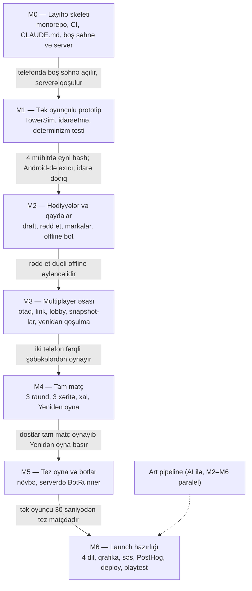

# Stampback — Development Planı v0.1

> Mənbə: claude.ai-dakı "Stampback — Development Planı v0.1" sənədi, 31 oktyabr 2026.
> Sənəd dəyişəndə bu nüsxəni də yeniləyin.

**Status:** M0 tamamlanıb. M1-T1–T5 tamamlanıb: oynanılan tək oyunçulu prototip, determinizm
CI-da 4 mühitdə (Node.js, Chromium, Firefox, WebKit) təsdiqlənib, smoke test telefon ölçülü
Chromium-da ekran şəkli çəkir (`smoke-screenshots` branch-i). Növbəti: M1-T6 — real telefonda
ölçmə və idarəetmə rəyi (istifadəçi tərəfindən).

## 1. Xülasə

Stampback MVP-si 7 milestone-da (M0–M6) hazırlanır; hər milestone oynanıla və ya yoxlanıla bilən nəticə ilə bitir və növbətiyə yalnız keçid meyarı ödəniləndə keçilir. Ən böyük iki risk (telefonda dəqiq yerləşdirmə və determinizm) M1-də, multiplayer-dən əvvəl yoxlanılır.

M0 və M1 tapşırıqları bu sənəddə tam yazılıb və dərhal icra oluna bilər. M2–M6 qısa siyahı şəklindədir: onlar M1 playtest-inin nəticələrinə görə dəqiqləşdiriləcək və hər biri başlamazdan əvvəl eyni formatda genişləndiriləcək. Əsas sənədlər: `docs/gdd.md` və `docs/architecture.md`.



Oxlar üzərindəki yazılar keçid meyarlarıdır: meyar ödənmədən növbəti milestone-a keçilmir.

## 2. Claude Code ilə iş qaydası

Claude Code-dan ən yaxşı nəticə qısa, dəqiq tapşırıqlar və hər addımdan sonra yoxlama ilə alınır. Aşağıdakı qaydalar Claude Code-un rəsmi best practices tövsiyələrinə əsaslanır ([sənədlər](https://code.claude.com/docs/llms.txt)).

**Hər tapşırıq üçün dövr:**

1. **Yeni sessiya.** Bir tapşırıq bir sessiyadır; tapşırıqlar arasında `/clear` ilə konteksti təmizləyin.
2. **Plan mode.** Shift+Tab ilə plan rejiminə keçin və tapşırıq mətnini tam yapışdırın. Claude əvvəl plan qurur; planı oxuyun, səhv yerləri düzəldin, sonra icraya icazə verin.
3. **İcra və yoxlama.** Claude kodu yazır və tapşırıqdakı yoxlama əmrlərini işlədir. Qəbul meyarlarının hər birini özünüz də yoxlayın.
4. **Diff-i oxuyun.** AI kodu başqa bir proqramçının kodu kimi nəzərdən keçirilir: anlamadığınız hissəni Claude-dan izah etməsini istəyin.
5. **Commit.** Hər tapşırıq ayrıca commit-dir, mesajında tapşırıq kodu olur (məsələn, `M1-T3: ghost preview`).

**Problem olanda:**

- Claude yanlış istiqamətə gedirsə, Esc ilə dayandırın; `/rewind` ilə əvvəlki vəziyyətə qayıtmaq olar.
- İki düzəliş cəhdindən sonra da düzəlmirsə, `/clear` edin və öyrəndiklərinizi əlavə edərək tapşırığı yenidən verin.
- Tapşırıq çox böyük gəlirsə, onu ikiyə bölün; burada dəyişiklik etmək normaldır.

**CLAUDE.md** qısa qalır (60 sətirdən az): layihənin məqsədi, əmrlər, əsas qaydalar və `docs/` fayllarına istinadlar.

## 3. Tapşırıq şablonu

Hər tapşırıq eyni altı hissədən ibarətdir və Claude Code-a bütöv şəkildə yapışdırılır. “Nəyi etmə” hissəsi xüsusilə vacibdir: Claude-un tapşırıqdan kənara çıxmasının qarşısını alır.

```markdown
## [Kod]: [Ad]

**Məqsəd:** bir-iki cümlə ilə nə əldə olunmalıdır.
**Oxu:** docs/ fayllarından aid bölmələr.
**Fayllar:** yaradılacaq və ya dəyişdiriləcək fayllar.
**Qəbul meyarları:**

- [ ] yoxlanıla bilən nəticə 1
- [ ] yoxlanıla bilən nəticə 2
      **Yoxlama:** işlədiləcək əmrlər və əl ilə yoxlama.
      **Nəyi etmə:** bu tapşırığa aid olmayan işlər.
```

## 4. M0 — Layihə skeleti ✅

M0-ın nəticəsi oyun məntiqi olmayan, amma bütün alətləri işləyən layihədir: bir əmrlə client və server qalxır, CI yaşıl işləyir. **Keçid meyarı:** telefonda brauzerdə boş Phaser səhnəsi açılır və serverlə əlaqə qurur.

- [x] **M0-T1: Monorepo və docs qovluğu** — pnpm workspaces, `shared` / `client` / `server`, strict TypeScript.
- [x] **M0-T2: CLAUDE.md** — 60 sətirdən az, əsas qaydalar və `docs/` istinadları.
- [x] **M0-T3: Keyfiyyət alətləri və CI** — ESLint (determinizm qaydaları daxil), Prettier, Vitest, GitHub Actions.
- [x] **M0-T4: Client skeleti** — Vite + Phaser 4 + Preact, 4 dildə i18n.
- [x] **M0-T5: Server skeleti və əlaqə testi** — Colyseus 0.18, boş `MatchRoom`, iki client eyni otaqda.
- [ ] **Keçid yoxlaması:** `pnpm dev` ilə telefonda açmaq (istifadəçi tərəfindən).

## 5. M1 — Tək oyunçulu prototip

> T1–T5 tamamlanıb. T6 real cihaz və oyunçular tələb edir.

M1 multiplayer-siz bir qüllə ilə iki əsas riski yoxlayır: telefonda dəqiq yerləşdirmə və brauzerlər arası determinizm. Qrafika sadə rəngli formalarla (placeholder) olur. **Keçid meyarı:** determinizm hash-ləri 4 mühitdə eynidir; referans Android telefonda 40 bağlamalı qüllə axıcı işləyir; 3–5 nəfər izahsız bağlamaları dəqiq yerləşdirə bilir.

### M1-T1: TowerSim nüvəsi

**Məqsəd:** `shared/physics`-də Rapier deterministik build üzərində bir qüllənin simulyasiyası.

**Oxu:** `docs/architecture.md`, bölmə 4 və 5; `docs/gdd.md`, bölmə 3.1 və 4.

**Fayllar:** `shared/physics/TowerSim.ts`, `shared/parcels/normal.ts` (7 tetromino, tam ədədli şəbəkə vahidlərində), `shared/maps/postOffice.ts` (geniş düz platforma), testlər.

**Qəbul meyarları:**

- [ ] `TowerSim` sabit 60 Hz addımla işləyir: `step()`, `spawnParcel()`, `release()`, `getHeight()`, `isSettled()`.
- [ ] İdarə olunan bağlama kinematik cisimdir; `release()` anında dinamik cismə çevrilir və bu an giriş jurnalına yazılır (tick, x, y, dönmə 0–3).
- [ ] Hündürlük yalnız sabitləşmiş (yatmış) cisimlərdən hesablanır; platformadan düşən bağlama silinir.
- [ ] Unit testlər: bir bağlama düşüb sabitləşir; hündürlük düzəlir; eyni jurnal iki dəfə eyni nəticə verir.

**Yoxlama:** `pnpm test`.

**Nəyi etmə:** render, input, hədiyyə bağlamaları, şəbəkə.

### M1-T2: Determinizm testi

**Məqsəd:** eyni giriş jurnalının Node.js, Chromium, Firefox və WebKit-də eyni dünya vəziyyətinə gətirdiyini avtomatik yoxlamaq.

**Oxu:** `docs/architecture.md`, bölmə 5 və 11.

**Fayllar:** `tools/determinism-check/` (3 hazır jurnal, hər biri 100+ bağlama), Playwright konfiqurasiyası, CI addımı.

**Qəbul meyarları:**

- [ ] Hər jurnal üçün müəyyən tick-lərdə Rapier dünya snapshot-ının hash-i 4 mühitdə eynidir.
- [ ] Fərq olduqda test hansı tick-də və hansı mühitdə ayrıldığını göstərir.
- [ ] Test CI-da işləyir və uğursuz olanda merge-i bloklayır.

**Yoxlama:** `pnpm determinism`; bir dəfə qəsdən `Math.sin` ilə başlanğıc dəyər verib testin sındığını görün, sonra geri qaytarın.

**Nəyi etmə:** server tərəfindən yoxlama (ranked üçündür, MVP-də yoxdur).

### M1-T3: MatchScene render

**Məqsəd:** `TowerSim` vəziyyətini Phaser 4-də çəkmək.

**Oxu:** `docs/architecture.md`, bölmə 8.

**Fayllar:** `client/src/scenes/MatchScene.ts`, `client/src/render/`.

**Qəbul meyarları:**

- [ ] Sabit addımlı dövr (accumulator) və render interpolasiyası var; fizika render tezliyindən asılı deyil.
- [ ] Platforma və bağlamalar konturlu rəngli formalarla çəkilir.
- [ ] Kamera qüllənin üstünü izləyir.
- [ ] Tab arxa plana keçəndə simulyasiya dayanır.

**Yoxlama:** bağlamaları debug əmri ilə avtomatik düşürüb qüllənin çəkilişinə baxın.

**Nəyi etmə:** son qrafika, səs, UI menyuları.

### M1-T4: Toxunma və klaviatura idarəsi

**Məqsəd:** GDD-dəki idarəetməni abstrakt əmrlər kimi qurmaq.

**Oxu:** `docs/gdd.md`, bölmə 6; `docs/architecture.md`, bölmə 8.

**Fayllar:** `client/src/input/`.

**Qəbul meyarları:**

- [ ] Toxunma: üfüqi nisbi sürüşdürmə = hərəkət, qısa toxunuş = döndərmə, aşağı sürüşdürmə = sürətli endirmə.
- [ ] Klaviatura: oxlar və WASD eyni əmrlərə çevrilir.
- [ ] Kölgə (ghost) bağlamanın düşəcəyi yeri göstərir və simulyasiyaya təsir etmir.
- [ ] Bağlama standart olaraq yavaş enir.

**Yoxlama:** referans Android telefonda və iPhone-da 20 bağlama yerləşdirin.

**Nəyi etmə:** draft və rədd et düymələri (M2).

### M1-T5: Ardıcıllıq, mükəmməl yerləşdirmə və HUD

**Məqsəd:** prototipi oynanıla bilən dövrə çevirmək.

**Oxu:** `docs/gdd.md`, bölmə 3.1 və 3.5.

**Fayllar:** `shared/rules/sequence.ts` (seed-li PRNG), `shared/rules/perfect.ts`, `client/src/hud/`.

**Qəbul meyarları:**

- [ ] Normal bağlamalar seed-li ardıcıllıqla gəlir; növbəti bağlama göstərilir.
- [ ] Mükəmməl yerləşdirmə GDD qaydası ilə aşkarlanır (1 saniyədə sabitləşmə, alt səthin ən azı 80%-i dəstəklənir) və unit testlə yoxlanılır.
- [ ] HUD hündürlüyü, mükəmməl yerləşdirmə sayını və itirilən bağlamaları göstərir.
- [ ] Debug paneli FPS-i və bir fizika addımının müddətini (ms) göstərir.

**Yoxlama:** 3 dəqiqə oynayın və HUD-un doğruluğunu yoxlayın.

**Nəyi etmə:** marka, xal, raund (M2 və M4).

### M1-T6: Ölçmə və M1 qiymətləndirməsi

**Məqsəd:** keçid meyarını real cihazlarda ölçmək və nəticəni yazmaq.

**Fayllar:** `docs/m1-report.md`.

**Qəbul meyarları:**

- [ ] Referans Android telefonda 40 bağlamalı qüllə ilə FPS və fizika addımı ölçülüb yazılıb.
- [ ] 3–5 nəfərin idarəetmə təcrübəsi qeyd olunub: harada çətinlik çəkdilər.
- [ ] Qərar yazılıb: idarəetmə kifayətdir, yoxsa GDD-dəki plan B (grid-ə yapışma) lazımdır.

**Yoxlama:** hesabatı oxuyun və M2-yə keçmək qərarını verin.

**Nəyi etmə:** problem tapılsa, dərhal düzəltməyə başlama; əvvəl hesabata yaz və ayrıca tapşırıq yarat.

## 6. M2–M6: qısa siyahı

Bu tapşırıqlar M1 hesabatından sonra dəqiqləşdiriləcək və hər milestone başlamazdan əvvəl bölmə 3-dəki şablonla tam yazılacaq.

| Kod   | Tapşırıq                                          | Bitdi sayılır, əgər                                                |
| ----- | ------------------------------------------------- | ------------------------------------------------------------------ |
| M2-T1 | 5 hədiyyə bağlaması (`shared/parcels/gifts.ts`)   | Hər birinin effekti testdə və ekranda görünür                      |
| M2-T2 | Draft qaydası və çeşidləmə lenti UI               | Hər 3 bağlamadan sonra 3 variant, 3 saniyə limiti, avtomatik seçim |
| M2-T3 | Hədəf qaydası, rədd et, markalar (`shared/rules`) | GDD bölmə 3.3–3.5-in hər qaydası unit testlə örtülüb               |
| M2-T4 | Göyərçin sürüsü                                   | 3 ardıcıl kombo liderə yumşaq təkan verir                          |
| M2-T5 | Yerli sadə bot rəqib (offline)                    | Hədiyyə göndərir, rədd edir, oyunu sonuna qədər oynayır            |
| M3-T1 | `MatchRoom` schema state və mesaj protokolu       | Arxitektura bölmə 6-dakı bütün mesajlar tipləşdirilib              |
| M3-T2 | Otaq kodu, link ilə qoşulma, host qaydaları       | Telefon linkdən 2 toxunuşla otaqdadır                              |
| M3-T3 | Preact lobby və otaq ekranı                       | Oyunçu siyahısı, host, paylaş düyməsi işləyir                      |
| M3-T4 | Snapshot-lar və rəqib panelləri                   | Rəqib qüllələri axıcı görünür (10 Hz + interpolasiya)              |
| M3-T5 | Şəbəkə üzərindən draft, hədiyyə, rədd et          | İki telefon arasında tam hədiyyə dueli işləyir                     |
| M3-T6 | Yenidən qoşulma və hündürlük yoxlamaları          | Wi-Fi söndürülüb açılanda oyunçu matça qayıdır                     |
| M4-T1 | 3 raund, 3 xəritə, xal sistemi                    | Tam matç GDD bölmə 5 üzrə keçir                                    |
| M4-T2 | Nəticə ekranı, zeplin, “Yenidən oyna”             | Eyni qrup yeni matça bir toxunuşla keçir                           |
| M4-T3 | Emote-lar və standart möhür                       | 4 emote, 3 saniyəlik limit                                         |
| M4-T4 | “Günün ən pis hədiyyəsi” kartı                    | Kart şəkil kimi paylaşıla bilir                                    |
| M5-T1 | Tez oyna növbəsi                                  | 4 nəfər toplananda matç başlayır                                   |
| M5-T2 | BotRunner (server)                                | 20 saniyədən sonra boş yerlər “Bot” nişanlı botlarla dolur         |
| M5-T3 | Bot–bot simulyasiya testləri                      | Gecəlik 100+ başsız matç çökmədən keçir                            |
| M6-T1 | i18n: az, en, tr, ru                              | Bütün mətnlər açarla, 4 dildə yoxlanılıb                           |
| M6-T2 | Real qrafika inteqrasiyası (bölmə 7)              | Placeholder qalmayıb                                               |
| M6-T3 | Səs effektləri və musiqi                          | iOS-da səs ilk toxunuşdan sonra işləyir                            |
| M6-T4 | PostHog eventləri və xəta izləmə                  | Arxitektura bölmə 9-dakı eventlər panelə düşür                     |
| M6-T5 | Colyseus Cloud staging və production              | `main`-dən avtomatik deploy                                        |
| M6-T6 | Playtest dövrəsi 1                                | GDD-dəki 3 qrupla playtest, hesabat yazılıb                        |

**Keçid meyarları:**

- **M2:** bota qarşı offline oyunda rədd et dueli əyləncəli hiss olunur (3–5 nəfərin rəyi).
- **M3:** iki telefon fərqli şəbəkələrdən (Wi-Fi və mobil internet) matç oynayır.
- **M4:** 4–6 dost tam 3 raundluq matç oynayır və “Yenidən oyna” basır.
- **M5:** tək oyunçu Tez oyna ilə 30 saniyədən tez matçdadır.
- **M6:** GDD-dəki MVP uğur meyarları ölçülə bilir və ilk playtest hesabatı hazırdır.

## 7. Vizual assetlər: AI ilə art pipeline

Qrafika AI alətləri ilə hazırlanır və iş M2 ilə paralel başlayır, çünki vahid stil tapmaq bir neçə iterasiya tələb edir. Əsas prinsip: AI yalnız tək-tək əşyaları və teksturaları yaradır; mətn, formaların birləşdirilməsi və animasiya kodla edilir.

**Addımlar:**

1. **Stil bələdçisi:** palitra, kontur qalınlığı, düz 2D öndən görünüş, “oyuncaq kimi komik poçt” təsviri. Stil sözlərlə təsvir olunur; mövcud oyunların, studiyaların və ya rəssamların adları prompt-da istifadə edilmir.
2. **Prompt şablonu:** sabit stil hissəsi + hər asset üçün qısa əlavə. Alət imkan verirsə, stil referansı şəkli və ya sabit seed istifadə olunur.
3. **Təmizləmə:** şəffaf fon, kənarların təmizlənməsi, vahid ölçü (retina üçün 2x).
4. **Atlas:** bütün spritelər Phaser-in dəstəklədiyi texture atlas-a yığılır; emal skriptlərini Claude Code yaza bilər.
5. **Qeydiyyat:** hər asset üçün istifadə olunan alət və prompt `docs/art-log.md`-də saxlanılır.

| Asset qrupu                         | Mənbə                                | Qeyd                                                                                            |
| ----------------------------------- | ------------------------------------ | ----------------------------------------------------------------------------------------------- |
| Normal bağlamalar                   | AI: 1 kvadrat karton qutu teksturası | 7 tetromino forması kodla kvadratlardan yığılır                                                 |
| 5 hədiyyə bağlaması                 | AI                                   | Seyf, dondurulmuş, şlyapa qutusu, KÖVRƏK, hava şarı; formaları fizika formasına uyğun olmalıdır |
| 3 xəritə fonu və platforması        | AI                                   | Poçt şöbəsi, yük maşını, dam üstü                                                               |
| Kuryer avatarları (6 rəng)          | AI                                   | Bir əsas personaj, rənglər kodla dəyişdirilir                                                   |
| Zeplin, göyərçinlər, emote ikonları | AI                                   | Animasiya Phaser tween-ləri ilə                                                                 |
| Möhürlər və etiketlər               | AI çərçivə + font ilə mətn           | AI şəkillərində mətn etibarsızdır və 4 dilə tərcümə lazımdır                                    |
| UI elementləri                      | Kod (CSS)                            | Düymələr, panellər, kartlar                                                                     |

**Hüquqi qeyd:** seçilən AI alətinin istifadə şərtləri kommersiya istifadəsinə icazə verməlidir; bunu aləti seçməzdən əvvəl yoxlayın. Bir sıra ölkələrdə AI ilə yaradılmış təsvirlərin müəllif hüququ ilə qorunması məsələsi hələ qeyri-müəyyəndir; brendin əsas elementlərini (loqo) sonradan əl ilə düzəltmək bu riski azaldır.

## 8. Risklər və növbəti addımlar

Ən böyük plan riski tapşırıqların səssizcə böyüməsidir; buna qarşı əsas alət hər tapşırıqdakı “Nəyi etmə” hissəsi və böyük tapşırığı ikiyə bölməkdir.

| Risk                                   | Tədbir                                                                                    |
| -------------------------------------- | ----------------------------------------------------------------------------------------- |
| Claude Code-da yeni olmaq              | M0 tapşırıqları aşağı riskli olduğu üçün iş dövrünü öyrənmək üçün idealdır                |
| Claude Code Phaser 3 API-si yaza bilər | Phaser 4-ün AI skill faylları (`node_modules/phaser/skills/`) CLAUDE.md-də istinad edilir |
| Android cihaz gec alınır               | Cihaz M1-T4-ə qədər lazımdır; ondan əvvəlki tapşırıqlar cihazsız işləyir                  |
| AI qrafikasında stil qeyri-sabitdir    | Stil bələdçisi və sabit prompt şablonu; erkən başlamaq                                    |
| M1-də idarəetmə uğursuz olur           | GDD-dəki plan B (grid-ə yapışma) M2-dən əvvəl tətbiq edilir                               |

**Növbəti addımlar:**

- [x] GitHub-da `stampback` repo-su yaradılıb.
- [x] GDD, arxitektura və development planı `docs/` qovluğundadır.
- [ ] Referans Android telefonu alın (M1-T4-dən əvvəl).
- [ ] M0 keçid yoxlaması: `pnpm dev` ilə telefonda açın.
- [ ] M1-T1 ilə davam edin.
- [ ] M1 hesabatından sonra bu sənədə qayıdıb M2 tapşırıqlarını genişləndirin.
