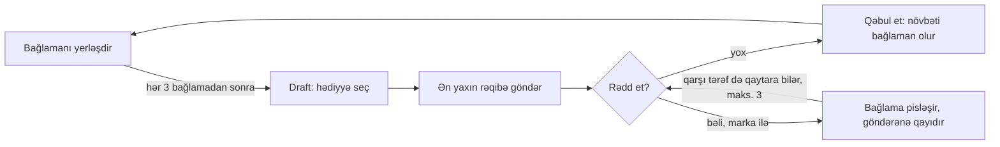

# Stampback — Game Design Document (GDD) v1.1

> Mənbə: claude.ai-dakı "Stampback — Game Design Document (GDD) v1.0" sənədi, 31 oktyabr 2026.
> Sənəd dəyişəndə bu nüsxəni də yeniləyin.

## Dəyişiklik qeydi: v1.1 (M1 playtest-indən sonra)

M1 prototipində istifadəçi oyunun Tetris kimi hiss olunduğunu bildirdi. Səbəb təkcə tetromino formaları deyildi:
yuxarıdan yavaş düşən idarə olunan fiqur, kölgə (ghost) və şəbəkəyə bağlı hərəkət birbaşa Tetris idarəetməsidir.
Qərar (istifadəçi tərəfindən təsdiqlənib):

- **Tetromino-lar yox, real qutular:** 7 növ düzbucaqlı qutu, ölçüləri yarım hüceyrə dəqiqliyi ilə
  (kub, kərpic, uzun, boru, böyük, enli, yeşik). Düzbucaqlı qutu yalnız 90° döndərilir (en ↔ hündürlük).
- **Düşən fiqur yox, çeşidləmə lenti:** ekranın altında 3 bağlamalı lent. Oyunçu istədiyi bağlamanı lentdən
  sürükləyib qüllənin üstündə buraxır, bağlama real fizika ilə düşür. Lentdəki bağlamaya toxunmaq onu döndərir.
- **Kölgə yox:** yalnız düşəcəyi yerə qədər nazik bələdçi xətlər.
- **Draft ilə birləşmə (M2-də dəqiqləşəcək):** lentdən gələn bağlamanı ya öz qüllənə qoyursan, ya da ən yaxın
  rəqibinə hədiyyə kimi atırsan. Ayrıca draft ekranı lazım olmaya bilər. Bölmə 3.2 M2 dizaynında yenilənəcək.

Aşağıdakı bölmələrdə 3.1, 4 (normal bağlamalar) və 6 (idarəetmə) bu qeydə görə oxunmalıdır.

## 1. Xülasə

**Stampback** (“stamp”, yəni möhür, və “send back”, yəni geri göndər, sözlərindən) 2–6 oyunçu üçün brauzerdə oynanılan, fizika əsaslı rəqabətli qüllə tikmə oyunudur. Oyunçular kuryerdir, hər biri öz bağlama qülləsini yığır.

**Pitch:** Fizika ilə bağlama qülləsi yığ, ən yaxın rəqibinə ən pis bağlamanı hədiyyə göndər; o isə onu daha da pisləşmiş halda sənə qaytara bilər.

**Janr:** physics puzzle + competitive party game.

**Əsas fərqləndirici xüsusiyyətlər:**

- **Oyunçu qərarı ilə sabotaj.** Rəqibə göndərilən blok təsadüfi deyil, sənin seçimindir (draft).
- **Rədd et dueli.** Gələn hədiyyə marka ilə göndərənə qaytarıla bilər, hər qaytarılışda bağlama pisləşir.
- **Ən yaxın rəqib qaydası.** Hər kəs hündürlükdə özündən bir pillə yuxarıdakı oyunçu ilə mübarizə aparır.
- **Poçt teması.** Mexanikalar intuitiv metaforalarla görünür: marka, möhür, KÖVRƏK qutu.
- **Brauzer + mobil.** Yükləmə yoxdur, link ilə otaq, toxunma ekranı üçün dizayn.

Ən yaxın mexanika rəqibi Tricky Towers-dir (PC və konsol, 4 oyunçuya qədər online). Onun brauzer analoqu yoxdur və sabotaj orada təsadüfi sehrlərdən gəlir.

## 2. Strateji qərarlar

Phase 2-nin əvvəlində üç strateji qərar təsdiqlənib. GDD-dəki bütün detallar bunlara tabedir.

| Sahə             | Qərar                                                     | Dizayna təsiri                                                                   |
| ---------------- | --------------------------------------------------------- | -------------------------------------------------------------------------------- |
| Hədəf auditoriya | 13–25 yaş, dost qrupları, Discord və streamer mədəniyyəti | PEGI 12 uyğunluğu, sərbəst mətn chat yoxdur, komik ton                           |
| Platforma        | Hər ikisi, touch-first                                    | İdarəetmə əvvəl toxunma ekranı üçün dizayn olunur, klaviatura sonra əlavə edilir |
| Monetizasiya     | Əvvəl reklam, sonra kosmetika                             | Launch portal reklamı ilə; kosmetika oyunçu bazası formalaşandan sonra           |
| Distribusiya     | Öz saytımız + CrazyGames tipli portallar                  | Otaq axını portalın instant multiplayer tələblərinə uyğun qurulur                |

**Dizayn prinsipləri:**

1. **5 saniyədə başa düşülür.** Yeni oyunçu ilk matçda qaydaları oxumadan oynaya bilməlidir.
2. **Sabotaj görünür.** Hər hədiyyənin kimdən gəldiyi və nə etdiyi ekranda aydın olmalıdır.
3. **Pay-to-win yoxdur.** Markalar və oyun üstünlüyü verən heç nə satılmır.
4. **Reklam matçın içində göstərilmir.** Yalnız matçlar arasında.
5. **Linkdən oyuna maksimum 2 toxunuş.** Qeydiyyat tələb olunmur.

## 3. Core loop və əsas qaydalar

Hər oyunçu öz platformasında qüllə yığır, ara-sıra rəqibinə hədiyyə göndərir və gələn hədiyyəni qəbul edir və ya qaytarır. Aşağıdakı rəqəmlər ilkin dəyərlərdir və playtest ilə balanslanacaq.

Qaytarılan bağlama hər dəfə pisləşir və qarşı tərəf onu yenidən qaytara bilər; üç qaytarılışdan sonra mütləq qəbul edilir.

### 3.1. Bağlamanı yerləşdirmək

- Bağlama qüllənin üstündə görünür. Oyunçu onu üfüqi hərəkət etdirir, 90° döndərir və sürətlə endirir.
- Bağlama fizika ilə düşür: çəki, sürtünmə və toqquşma realdır.
- Növbəti bağlama əvvəlcədən göstərilir (1 ədəd preview).
- Platformadan düşən bağlama itirilir.
- **Hündürlük** qüllənin ən yüksək sabit nöqtəsi ilə ölçülür. Hərəkətdə olan bağlama sayılmır.
- **Mükəmməl yerləşdirmə:** bağlama 1 saniyə ərzində sabitləşir və alt səthinin ən azı 80%-i dəstəklənir.

### 3.2. Draft: çeşidləmə lenti

- Hər 3 normal bağlamadan sonra lentdə 3 hədiyyə bağlaması görünür.
- Oyunçu 3 saniyə ərzində birini seçir və o, avtomatik rəqibə göndərilir. Seçməsə, təsadüfi biri gedir.
- Seçim zamanı öz bağlamasının idarəsi dayanmır.

### 3.3. Hədəf qaydası: ən yaxın rəqib

- Hədiyyə hündürlükdə göndərəndən bir pillə yuxarıdakı oyunçuya gedir. Lider ikinci yerə göndərir.
- Bərabər hündürlükdə o hündürlüyə daha tez çatan yuxarıda sayılır.
- Ünvan göndərmə anında kilidlənir və sonra dəyişmir.
- Hər oyunçunun üstündə eyni anda ən çox 1 gözləyən hədiyyə ola bilər. Hədəf məşquldursa, hədiyyə bir pillə yuxarıya gedir; hamı məşquldursa, növbəyə dayanır.
- 2 oyunçulu matçda hədiyyə həmişə rəqibə gedir.

### 3.4. Rədd et dueli

- Gələn hədiyyə qüllənin üstündə bağlama kimi 2 saniyə asılı qalır.
- Oyunçu heç nə etməsə, hədiyyə qəbul edilir və növbəti bağlaması olur.
- **Rədd et** markaya başa gəlir və hədiyyəni birbaşa göndərənə qaytarır. Qaytarılan hədiyyə “1 gözləyən hədiyyə” limitinə tabe deyil.
- Qiymət hər qaytarılışda artır: 1-ci qaytarılış 1 marka, 2-ci 2 marka, 3-cü 3 marka.
- Hər qaytarılışda bağlama pisləşir: ölçüsü +25%, kütləsi +50%, üzərinə yeni möhür vurulur.
- 3 qaytarılışdan sonra bağlama “QAYTARILMAZ” olur və mütləq qəbul edilir.

### 3.5. Markalar

- Oyunçu ən çox 3 marka saxlaya bilər. Raundun əvvəlində 0 marka.
- +1 marka: mükəmməl yerləşdirmə.
- +1 marka: qəbul edilən hədiyyəni “həzm etmək”, yəni sonrakı 3 saniyədə heç bir bağlama itirməmək.

### 3.6. Göyərçin sürüsü (catch-up)

- Ardıcıl 3 mükəmməl yerləşdirmə liderə göyərçin sürüsü göndərir: qülləyə yandan yüngül təkan.
- Liderin özü bu kombonu edərsə, göyərçin göndərilmir, əvəzinə +1 marka alır.
- Təkan yumşaq olmalıdır: düzgün tikilmiş qülləni dağıtmamalı, yalnız zəif qülləni cəzalandırmalıdır.

## 4. Bağlamalar

Oyunda iki növ bağlama var: normal bağlamalar hər kəs üçün eynidir, hədiyyə bağlamaları isə yalnız draft vasitəsilə rəqibə göndərilir. MVP-də 5 hədiyyə bağlaması olacaq.

**Normal bağlamalar:** 7 klassik tetromino formasında (I, O, T, L, J, S, Z) skotçla bağlanmış karton qutular. Bütün oyunçular eyni ardıcıllığı alır ki, fərqi şans yox, bacarıq yaratsın.

**Hədiyyə bağlamaları:**

| Bağlama             | Effekt                                                                | Niyə maraqlıdır                                                                | MVP         |
| ------------------- | --------------------------------------------------------------------- | ------------------------------------------------------------------------------ | ----------- |
| Ağır seyf           | Kütləsi normalın 3 qatı; qülləni bir tərəfə əyir                      | Mərkəzə qoyulsa, əslində əsası möhkəmləndirir                                  | Bəli        |
| Dondurulmuş bağlama | Sürtünmə çox aşağı; sürüşür                                           | Üstünə qoyulan hər şey də sürüşə bilər                                         | Bəli        |
| Şlyapa qutusu       | Yumru formalıdır, yuvarlanır                                          | Boşluqda “paz” kimi sıxışdırıla bilər                                          | Bəli        |
| KÖVRƏK qutu         | Üstünə sərt düşən bağlama olarsa, sınır və 3 kiçik qırıntıya çevrilir | Diqqətli oyunçunu yavaşladır, tələskəni cəzalandırır                           | Bəli        |
| Hava şarlı bağlama  | Yuxarı qaldırma qüvvəsi var                                           | Düzgün yerləşdirilərsə, qülləni sabitləşdirir; bacarıqlı oyunçu üçün fürsətdir | Bəli        |
| Yırtıq kisə         | 8 saniyədə ölçüsünün 50%-ni itirir                                    | Üstündəki hissə zəifləyir                                                      | Xeyr (v1.1) |
| Canlı göndəriş      | İçindəki pişik hər 4–6 saniyədən bir qutunu tərpədir                  | Ən gülməli və viral an                                                         | Xeyr (v1.1) |

**Draft qaydası:** lentdəki 3 hədiyyə hər dəfə hədiyyə hovuzundan təkrarsız seçilir. Beləliklə seçim həmişə real qərardır.

## 5. Oyun rejimləri və matç strukturu

Bir matç 3 raunddan ibarətdir və 6–8 dəqiqə çəkir. Qalib 3 raund üzrə ən çox xal toplayan oyunçudur.

| Rejim        | Qələbə şərti                                                                        | Raund müddəti  | Oyunçu sayı | MVP         |
| ------------ | ----------------------------------------------------------------------------------- | -------------- | ----------- | ----------- |
| Yarış (əsas) | Qüllə ilk olaraq zeplinə (finiş xətti) çatır; vaxt bitərsə, ən hündür qüllə         | Maks. 3 dəqiqə | 2–6         | Bəli        |
| Survival     | 3 müştəri şikayəti (itirilən bağlama) olan oyundan çıxır; sonuncu qalan qalib gəlir | Maks. 3 dəqiqə | 2–6         | Xeyr (v1.1) |
| 1v1 duel     | Yarış qaydaları, amma hər 2 normal bağlamadan sonra draft                           | Maks. 2 dəqiqə | 2           | Xeyr (v1.1) |

**Raund xalları (yarış rejimi):**

- 1-ci yer: 5 xal, 2-ci: 3 xal, 3-cü: 2 xal, digərləri: 1 xal.
- “Sənin hədiyyən” bonusu: göndərdiyin hədiyyə rəqibinə bağlama itirtdirərsə, +1 xal (raundda maks. 2).
- Bərabər xalda daha çox raund birinciliyi olan qalib gəlir.

**Raund axını:** 3 saniyəlik geri sayım → raund → qalibin zeplinlə göyə qalxma animasiyası → 5 saniyəlik nəticə ekranı → növbəti raund. Matç sonunda “Ayın işçisi” ekranı və “Yenidən oyna” düyməsi.

**Xəritələr:** hər raund fərqli xəritədə keçir, qüllələr raundlar arasında sıfırlanır. Bütün oyunçular eyni xəritədə oynayır; xəritə yalnız platformanın formasını və bir ətraf mühit xüsusiyyətini dəyişir. MVP-də 3 xəritə var və sıra sabitdir:

| Raund | Xəritə      | Platforma    | Xüsusiyyət                                                      |
| ----- | ----------- | ------------ | --------------------------------------------------------------- |
| 1     | Poçt şöbəsi | Geniş və düz | Yoxdur; öyrənmə xəritəsi                                        |
| 2     | Yük maşını  | Dar          | Maşın hərəkətdədir, platforma yüngül yellənir                   |
| 3     | Dam üstü    | Orta enli    | Ortada baca çıxıntısı var, qüllə qeyri-bərabər əsasdan başlayır |

## 6. İdarəetmə

İdarəetmə əvvəl bir əlin baş barmağı ilə telefonda oynamaq üçün dizayn olunur, klaviatura isə eyni hərəkətlərin qarşılığıdır. Əsas risk toxunma ekranında dəqiq yerləşdirmədir, ona görə aşağıdakı köməkçilər MVP-nin məcburi hissəsidir.

| Hərəkət                              | Toxunma                                                                           | Klaviatura        |
| ------------------------------------ | --------------------------------------------------------------------------------- | ----------------- |
| Bağlamanı sola/sağa hərəkət etdirmək | Ekranın istənilən yerində üfüqi sürüşdürmə (nisbi idarə, barmaq bağlamanı örtmür) | ← / → və ya A / D |
| 90° döndərmək                        | Qısa toxunuş                                                                      | ↑ və ya W         |
| Sürətli endirmək                     | Aşağı sürüşdürmə                                                                  | ↓ və ya S         |
| Draft seçimi                         | Aşağıdakı 3 kartdan birinə toxunmaq                                               | 1 / 2 / 3         |
| Rədd et                              | Yalnız hədiyyə gələndə görünən böyük düymə, baş barmağa yaxın küncdə              | Space             |

**Dəqiqlik köməkçiləri:**

- **Kölgə (ghost):** bağlamanın düşəcəyi yer əvvəlcədən şəffaf kölgə kimi göstərilir.
- **Yavaş standart düşmə:** bağlama özü yavaş enir, oyunçunun düşünməyə vaxtı olur; sürət yalnız oyunçunun qərarıdır.
- **Ekran düzülüşü:** öz qüllən ekranın əsas hissəsini tutur, rəqiblər kiçik paneldə görünür. Hədiyyə göndərdiyin rəqibin paneli qısa müddət böyüyür ki, nəticəni görə biləsən.
- **Yalnız rəngə güvənməmək:** hər oyunçu rəng + ikon + ad ilə fərqlənir.

## 7. Otaq və multiplayer axını

Oyunun əsas giriş nöqtəsi dostlarla özəl otaqdır: linkdən oyuna maksimum 2 toxunuş. Otaq 2–6 oyunçu tutur.

**Otaq yaratmaq və qoşulmaq:**

1. Oyunçu “Dostlarla oyna” düyməsinə toxunur və otaq dərhal standart parametrlərlə yaranır.
2. Ekranda link və 4 simvollu kod (məsələn, K7QX) görünür; “Paylaş” düyməsi telefonun paylaşma menyusunu açır.
3. Dost linki açır, əvvəlcədən doldurulmuş təsadüfi kuryer adını təsdiqləyir və otaqdadır. Kodla qoşulmaq üçün ana ekranda “Kod ilə qoşul” var.
4. Host rejimi seçir və matçı başladır (minimum 2 oyunçu).

**Otaq qaydaları:**

- Otaq matçlar arasında qalır; “Yenidən oyna” eyni qrupu yeni matça aparır.
- Host çıxarsa, host hüququ növbəti oyunçuya keçir.
- Matç gedərkən qoşulan oyunçu izləyici kimi gözləyir və növbəti matça daxil olur.
- Bağlantısı kəsilən oyunçu 30 saniyə ərzində geri qayıda bilər; bu müddətdə onun qülləsi dondurulur və ona hədiyyə göndərilmir.

**Tez oyna (public):** tək gələn oyunçular, xüsusilə portal trafiki üçün, təsadüfi oyunçularla 4 nəfərlik matç. Növbə 20 saniyə ərzində dolmasa, boş yerlər botlarla doldurulur.

**Botlar:**

- Bot həmişə açıq şəkildə “Bot” nişanı ilə göstərilir; oyunçunu insanla oynadığına inandırmaq məqsəd deyil.
- MVP-də 1 çətinlik səviyyəsi var, orta insan oyunçudan bir qədər zəif.
- Yerləşdirmə: sadə qayda ilə ən aşağı sabit mövqe seçilir, arabir qəsdən səhv edilir.
- Draft: hədiyyəni sadə prioritet cədvəli ilə seçir; rədd et: ən azı 2 markası olanda istifadə edir.
- Host özəl otağa da bot əlavə edə bilər; bu, 2 nəfərlik dost qrupları və test üçün faydalıdır.
- Botlu matçlar gələcək ranked reytinqinə təsir etmir.

**Portal inteqrasiyası:** portal “instant multiplayer” ilə açdıqda oyunçu birbaşa yeni özəl otağa düşür, otaq məlumatı portalın dəvət sisteminə ötürülür. Texniki detallar arxitektura sənədindədir.

## 8. Sosial sistem

Oyunda sərbəst mətn chat olmayacaq; ünsiyyət möhürlər və emote-lar ilə qurulur. Bu qərar moderasiya xərcini aradan qaldırır, 13+ auditoriya üçün təhlükəsizdir və möhür kosmetikasını dəyərli edir. Dostlar onsuz da çox vaxt Discord və ya səsli zəngdə danışır.

- **Şəxsi möhür:** hədiyyəni qaytaranda bağlamanın üzərinə sənin möhürün vurulur və rəqib onu görür. MVP-də hər kəsin standart “GERİ QAYTARILDI” möhürü var.
- **Emote-lar:** 4 hazır reaksiya (məsələn, gülən üz, “sənə hədiyyə!”, şok, səbir), raundda hər 3 saniyədə birdən çox olmayaraq.
- **Oyunçu adları:** təsadüfi kuryer adları təklif olunur; sərbəst ad üçün söz filtri tətbiq edilir.
- **Paylaşıla bilən an:** matç sonunda “Günün ən pis hədiyyəsi” kartı: ən çox qaytarılan bağlama, kimdən kimə getdiyi. MVP-də sadə şəkil kartı kimi.

## 9. Proqressiya və monetizasiya

Monetizasiya iki mərhələlidir: launch reklamla, kosmetika isə oyunçu bazası formalaşandan sonra. Hər iki mərhələdə satılan heç bir şey oyun üstünlüyü vermir.

**Proqressiya (v1.1):**

- Hesab tələb olunmur; qonaq profili cihazda saxlanılır. Hesab yalnız cihazlar arası sinxronizasiya və alış üçün lazımdır.
- Hər matç XP verir və “Kuryer dərəcəsi” artır. Dərəcələr pulsuz kosmetika açır.

**Mərhələ 1 — reklam (launch):**

- Interstitial reklam yalnız matçlar arasında, maksimum hər 2 matçdan bir.
- Rewarded video yalnız kosmetik məqsədlə (məsələn, bir matç üçün xüsusi möhürü sınamaq).
- Raundun və otaq gözləməsinin içində reklam yoxdur.

**Mərhələ 2 — kosmetika:**

- Şəxsi möhürlər (əsas məhsul), kuryer formaları, qutu dizaynları. Göndərdiyin hədiyyə sənin qutu dizaynında görünür, yəni kosmetika rəqiblərə də nümayiş olunur.
- Mövsümi tədbirlər: Yeni il “poçt mövsümü” əsas təqvim tədbiridir.

**Qadağalar:** markalar, draft üstünlüyü və oyun parametrləri satılmır. Loot box istifadə edilmir; 13+ auditoriya və tənzimləmə riskləri bunu məqsədəuyğun etmir.

## 10. Vizual və audio istiqamət

Vizual ton real poçt deyil, şişirdilmiş, oyuncaq kimi, komik “cizgi filmi poçtu”dur. Bu, temaya “darıxdırıcı” görünmə riskinə qarşı əsas müdafiədir.

- **Üslub:** 2D, qalın konturlar, isti rənglər, karton və skotç teksturaları. Kiçik ekranda oxunaqlı sadə formalar.
- **Oxunaqlılıq birinci:** hər hədiyyə bağlaması forması və ikonu ilə bir baxışda tanınmalıdır (seyf, buz, şlyapa, KÖVRƏK etiketi, şar).
- **Möhürlər və etiketlər:** “GERİ QAYTARILDI”, “TƏCİLİ”, “QAYTARILMAZ” — əsas vizual dil budur və oyunçuya vəziyyəti mətnsiz izah edir.
- **Animasiya:** bağlama düşəndə yüngül “squash”, möhür vurulanda ekran titrəməsi, zeplinlə qələbə anı.
- **Audio:** karton zərbə səsləri, möhür “tak” səsi, qaytarılanda artan gərgin musiqi notu, pişik miyovu (v1.1). Musiqi yüngül, ritmik poçt ofisi əhval-ruhiyyəsində.
- **Dil:** launch dilləri Azərbaycan, ingilis, türk və rus dilləridir. İnterfeys uzun tərcümələrə görə çevik dizayn olunur, vizual dil (möhürlər, ikonlar) mətnsiz də başa düşülür.

## 11. MVP həcmi

MVP-nin yeganə məqsədi bir suala cavab verməkdir: dostlar bir matçdan sonra “Yenidən oyna” düyməsini basırmı? Bu suala təsir etməyən hər şey sonraya saxlanılır.

| Sahə                | MVP-də var                                                                 | MVP-dən sonra                                   |
| ------------------- | -------------------------------------------------------------------------- | ----------------------------------------------- |
| Core loop           | Yerləşdirmə, draft, ən yaxın rəqib qaydası, rədd et, markalar, göyərçinlər | —                                               |
| Hədiyyə bağlamaları | 5 ədəd: ağır seyf, dondurulmuş, şlyapa qutusu, KÖVRƏK, hava şarlı          | Yırtıq kisə, canlı göndəriş, yeniləri           |
| Rejimlər            | Yarış, 3 raund, 3 xəritə                                                   | Survival, 1v1 duel                              |
| Multiplayer         | Özəl otaq (link + kod), 2–6 oyunçu, Tez oyna, botlar (1 çətinlik)          | Ranked, dost siyahısı, bot çətinlik səviyyələri |
| Platforma           | Mobil brauzer + desktop, touch və klaviatura                               | Portal SDK-larının tam inteqrasiyası            |
| Sosial              | Standart möhür, 4 emote, “Günün ən pis hədiyyəsi” kartı                    | Şəxsi möhürlər                                  |
| Proqressiya         | Yoxdur                                                                     | XP, Kuryer dərəcəsi                             |
| Monetizasiya        | Yoxdur (yalnız reklam yerləri dizaynda nəzərə alınır)                      | Reklam, sonra kosmetika                         |
| Dil                 | Azərbaycan, ingilis, türk, rus                                             | Əlavə dillər                                    |

**MVP uğur meyarları (ilkin hədəflər):**

- Otaqların ən azı 50%-i ikinci matçı oynayır.
- Orta sessiya ən azı 3 matçdır.
- Playtest-də yeni oyunçuların ən azı 80%-i ilk matçda izahsız rədd et mexanikasını istifadə edir.

## 12. Risklər və playtest hipotezləri

Ən böyük risk toxunma ekranında dəqiq yerləşdirmədir, çünki o, touch-first qərarının əsasını sarsıda bilər. Hər risk üçün playtest-də yoxlanacaq hipotez və plan B var.

| Risk                                   | Yoxlanacaq hipotez                                                         | Plan B                                                    |
| -------------------------------------- | -------------------------------------------------------------------------- | --------------------------------------------------------- |
| Toxunma ekranında dəqiqlik             | Telefon oyunçuları desktop oyunçularından əhəmiyyətli dərəcədə geri qalmır | Grid-ə yapışma (snap), daha yavaş düşmə, böyük bağlamalar |
| İkinci yerə təzyiq                     | 1 gözləyən hədiyyə limiti ikinci yeri haqsız cəzalandırmır                 | Lider ümumiyyətlə hədiyyə göndərmir, yalnız marka alır    |
| Bacarıqlı oyunçu hər şeyi rədd edir    | 3 marka limiti və artan qiymət bunu balanslayır                            | Marka qazanma tezliyini azaltmaq                          |
| Qərar yükü                             | Yeni oyunçu yerləşdirmə, draft və rədd et-i eyni anda idarə edir           | İlk matçda draft avtomatik, rədd et 2-ci raunddan açılır  |
| İki nəfərin dueli üçüncüyə xeyir verir | Oyunçular bunu cəza kimi yox, “siyasət” kimi qəbul edir                    | Qaytarılış sayını 2-yə endirmək                           |
| Tema cəlbedici deyil                   | 13–25 yaş oyunçular stili “şux” sayır                                      | Vizual tonu daha xaotik və parlaq etmək                   |
| Fizika sinxronizasiyası                | Rəqib qüllələri kiçik paneldə inandırıcı görünür                           | Texniki mərhələdə həll ediləcək                           |

**Bot riski:** fizika qülləsində inandırıcı bot yazmaq MVP həcmini artırır. Hipotez: sadə qayda ilə işləyən bot oyunçunu darıxdırmır və Tez oyna matçını xəlvətcə tamamlamaq üçün kifayətdir. Plan B: botlar yalnız draft və rədd et qərarları verir, bağlamaları isə əvvəlcədən hazırlanmış qüllə şablonları üzrə yerləşdirir.

**Playtest planı (ilkin):** 3 dövrə, hər birində 4–6 nəfərlik 3 dost qrupu. Oyunçulara qaydalar izah olunmur, yalnız müşahidə edilir və matçdan sonra 3 sual verilir: nə əyləndirdi, nə əsəbiləşdirdi, yenidən oynayarsanmı?

## 13. Açıq suallar və növbəti addımlar

Dörd açıq sualın hamısı bağlanıb; yalnız adın rəsmi hüquqi yoxlaması launch-dan əvvəl tamamlanmalıdır.

- [x] Tez oyna: növbə 20 saniyədə dolmasa, boş yerlər botlarla doldurulur (bölmə 7).
- [x] Launch dilləri: Azərbaycan, ingilis, türk və rus (bölmə 10 və 11).
- [x] Rejim axını: hər raund fərqli xəritədə, qüllələr sıfırlanır (bölmə 5).
- [x] Yekun ad: **Stampback**. “Return to Sender” Steam-də artıq ən azı iki oyun tərəfindən istifadə olunduğu üçün rədd edildi.
- [ ] Launch-dan əvvəl: ticarət nişanı (WIPO Global Brand Database, EUIPO, USPTO, Azərbaycan Əqli Mülkiyyət Agentliyi) və domen (stampback.io, stampback.com) rəsmi yoxlaması.

**Ad yoxlaması üçün mənbələr:** [Return to Sender, Steam app 1481500](https://store.steampowered.com/app/1481500?l=swedish) · [Return to Sender, Carl Games, 2020](https://www.dekudeals.com/items/return-to-sender) · [Stampede, WizKids stolüstü oyunu](https://wizkids.com/?p=16469)
